# APT WATCH · 서울 아파트 시장심리지수

> **공개 서비스**: [https://raspos.github.io/apt-watch/](https://raspos.github.io/apt-watch/)  
> **공개 기준일**: 2026년 11월 12일 기준  
> **경제·금융 데이터저널리즘 WATCH 시리즈**: [BOK WATCH](https://bokwatch.pages.dev/) · [FX WATCH](https://raspos.github.io/fx-odds/) · [DEBT WATCH](https://debtwatch.pages.dev/) · **APT WATCH**

APT WATCH는 국토교통부 실거래 데이터(45만 건)와 네이버 부동산 실시간 호가 데이터를 결합하여 서울 아파트 시장의 매도인-매수인 간 심리 괴리 및 가격 조정을 관측하는 오픈 데이터 분석 서비스입니다.

---

## 1. 단지 모집단 및 표본 체계

APT WATCH는 데이터의 통계적 정합성을 위해 단지 집합의 성격을 명확히 구분합니다.

| 구분 | 규모 | 설명 |
|---|---|---|
| **실거래 후보군** | 8,788개 단지 | 국토교통부 18개년 실거래 데이터(450,479건)에 존재하는 서울 아파트 전체 단지 |
| **전수 매핑 단지 (Universe)** | **5,821개 단지** | 서울 25개 자치구 전역에서 지번·단지명·네이버 고유 단지 ID 매핑이 완료된 전수 단지군 |
| **일일 고정 관측 단지 (Core)** | **375개 단지** | 25개 자치구별 실거래 빈도 상위 15개 핵심 랜드마크 대단지 (매일 아침 06:00 고정 관측) |
| **권역별 순환 관측 단지 (Rolling)** | **5,446개 단지** | 서울 5대 권역(도심·동남·동북·서북·서남)으로 분할하여 주기적으로 순환 수집하는 잔여 단지군 |
| **현재 실측 수집 완료 단지** | **110개 단지** | 2026-11-12 기준 실시간 호가(11,993건) 및 스냅샷 수집이 100% 완료된 기준선 단지 |

---

## 2. 3대 핵심 지표 체계

1. **가격괴리지수 (Price Divergence Index)**
   - **정의**: 동일 단지·전용면적·층 구간(저/중/고)의 현재 네이버 호가와 최근 90일 국토교통부 실거래 기준가격의 차이율(%).
   - **구분 배지**:
     - `90일 실거래`: 최근 90일 내 동일 그룹 국토부 실거래 3건 이상 확보 (엄격 실측치)
     - `180일 실거래`: 180일 내 실거래 기준 산출 (장기 실측 참고치)
     - `비교자료 부족`: 12개월 내 비교 거래 부재 시 산출 유보
   - **원칙**: 자치구별 표본이 부족한 초기 단계에서는 단일 서울 대표지수로 과장하지 않고 22개 구 참고치(+5.4%)로 엄격 분리 표기.

2. **호가조정지수 (Asking Adjustment Index)**
   - **정의**: 매일 연속 관측된 동일 매물 고유 ID를 추적하여 매도인의 가격 인상·인하 행동 비율 측정.
   - **원칙**: 고정 표본과 순환 표본을 혼합하지 않으며, 서로 다른 실제 관측일(Day 1 < Day 2)에 동일 ID가 재관측된 매물만으로 순호가조정률 산출.

3. **거래활력지수 (Transaction Vitality Index)**
   - **정의**: 최근 30일 계약 건수 대비 일평균 관측 매물 수의 비율로 매물 소화력 측정.

---

## 3. 수집시간 실측 벤치마크

Playwright 헤드리스 브라우저 환경에서 서울 아파트 단지 호가 수집 시간을 실측한 결과는 다음과 같습니다.

* **단지 규모별 실측 소요시간**:
  - 소형 단지 (매물 10건 미만): **6.2초 ~ 7.1초** (평균 6.85초)
  - 중형 단지 (매물 10~50건): **10초 ~ 15초**
  - 대형 랜드마크 단지 (매물 100건 이상): **30초 ~ 35초** (카드 확장 및 다중 그룹 렌더링 대기)
* **모집단 전체 평균 실측치**: **단지당 약 20.1초 ~ 20.3초**
* **순환 주기 계산**:
  - 375개 핵심 단지: 단일 프로세스 실행 시 약 45분~75분 소요 (매일 06:00 KST 고정 실행)
  - 5,446개 순환 단지: 일일 300~500단지 순환 수집 시 **약 11일 ~ 18일 주기**로 서울 전역 1회 완전 순환 관측.

---

## 4. 단일 운영 자동화 아키텍처

로컬 수집부터 외부 사이트 배포까지의 운영 경로는 단 하나의 견고한 파이프라인으로 확정되었습니다.

```mermaid
flowchart LR
    A["Windows 작업 스케줄러<br>(매일 06:00 KST)"] --> B["scripts/daily_operation.py"]
    B --> C["supervise_naver.py<br>(호가 수집 & 원본 스냅샷)"]
    C --> D["SQLite DB 적재<br>(data/history.sqlite3)"]
    D --> E["3대 지표 엔진 계산<br>(apt_watch.py / market_metrics.py)"]
    E --> F["공개 집계 파일 갱신<br>(site/data.json)"]
    F --> G["16개 단위테스트 검증<br>(python -m unittest)"]
    G --> H["Git Auto Commit & Push<br>(origin main)"]
    H --> I["GitHub Actions<br>(deploy.yml)"]
    I --> J["공개 GitHub Pages 배포<br>(raspos.github.io/apt-watch)"]
```



* **보안 및 무결성**:
  - 원시 매물 상세 데이터와 개인 SQLite DB(`history.sqlite3`), 스냅샷은 로컬에만 보존 (`.gitignore` 적용).
  - 외부 깃허브에는 검증된 집계 결과인 `site/data.json`만 안전하게 배포.

---

## 5. 주요 실행 명령어

* **일일 정기 운영 (375개 핵심 단지 수집 + 지표 산출 + Git 푸시)**:
  ```powershell
  python scripts/daily_operation.py
  ```

* **전수 순환 수집기 (5,821개 단지 관리)**:
  ```powershell
  # 핵심 375개 단지 수집
  python scripts/full_universe_runner.py --mode core

  # 미관측 단지 우선 50개 순환 수집
  python scripts/full_universe_runner.py --mode rolling --limit 50

  # 특정 권역 수집 (예: 도심권)
  python scripts/full_universe_runner.py --zone 도심권

  # 특정 자치구 전수 수집 (예: 강남구 11680)
  python scripts/full_universe_runner.py --district 11680
  ```

* **사후 분석 및 대시보드 데이터 재생성**:
  ```powershell
  python scripts/run_post_collection_pipeline.py
  ```

* **단위 테스트 실행**:
  ```powershell
  python -m unittest discover -s tests -v
  ```
