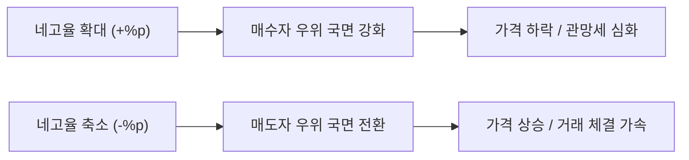
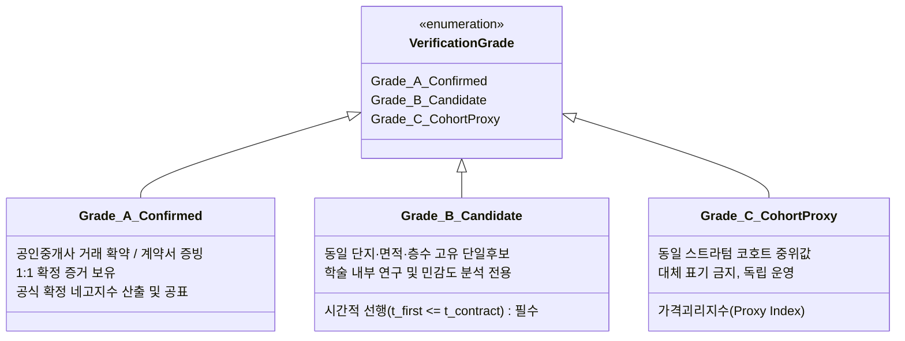

# APT WATCH — 네고지수(NEGO INDEX) 산출 방법론 및 지표 체계 정의서

**문서 버전:** v1.1.0 (2026. 11. 13 개정)  
**작성 기준일:** 2026년 11월 13일  
**연구 주체:** APT WATCH 데이터저널리즘 랩  
**서비스 URL:** [https://raspos.github.io/apt-watch/](https://raspos.github.io/apt-watch/)  
**저장소:** [https://github.com/raspos/apt-watch](https://github.com/raspos/apt-watch)  

---

## 1. 프로젝트의 근본 문제의식 및 연구 질문

부동산 시장에서 주택가격은 매도자의 요구가격(호가)과 매수자의 지불용의 사이의 치열한 탐색과 교섭(Bargaining)을 거쳐 최종 계약가격(실거래가)으로 확정됩니다. 그러나 기존 공공 및 민간 통계(한국부동산원 주간동향, KB부동산 주택가격동향 등)는 **이미 체결되어 신고된 사후적 실거래가격** 또는 **전문 조사원 및 표본 중개업소의 정기 조사 가격**을 집계하므로, 급변기 시장의 가격 양보(Concession)를 실시간 반영하는 데 구조적 시차가 존재합니다.

APT WATCH는 다음과 같은 근본 질문에서 출발합니다:
> **"아파트 매도 호가는 실제 계약 과정에서 얼마나 깎이는가(네고되는가)? 그리고 그 네고 폭의 변화는 향후 시장 가격의 방향을 기존 통계보다 먼저 예고할 수 있는가?"**

### 3대 핵심 연구 질문 (Research Questions)
1. **[Q1. 수준] 매도자가 최초 및 최종적으로 요구한 호가와 실제 체결된 거래가격 사이에는 구조적으로 얼마의 가격 격차(Observed Price Gap)가 발생하는가?**
2. **[Q2. 동학] 그 격차(네고율)는 시간에 따라 확대되는가, 아니면 축소되는가? (주간·월간 변화폭 %p 관측)**
3. **[Q3. 선행성] 네고 폭의 확대 및 축소 신호는 4주~12주 후 실제 아파트 실거래가격 및 거래량의 변화와 통계적으로 유의미한 선행 관계를 갖는가?**

---

## 2. 3대 가격의 엄격한 분리 및 정의

호가와 실거래가의 차이를 다룰 때 가장 빈번하게 발생하는 통계적 오류는 시점이 서로 다른 호가를 혼용하거나, 포털 최초 등록일과 시스템 최초 수집일을 동일시하는 것입니다. APT WATCH는 데이터를 다음 3가지 가격으로 엄밀하게 분리하여 관리합니다.

| 가격 개념 | 기호 | 정의 | 관측 방식 및 한계 |
| :--- | :---: | :--- | :--- |
| **최초 관측 호가** | $P_{\text{ask}, 0}$ | 수집 시스템 크롤러가 포털에서 해당 매물을 처음 탐지한 시점의 매도 희망가격 | 크롤러의 최초 관측 시점 매물 가격 (`firstPrice`). 포털 실제 최초 등록 시점과 수집 주기 사이의 관측 시차가 존재할 수 있음. |
| **최종 확인 호가** | $P_{\text{ask}, \text{last}}$ | 계약일 직전까지 포털에서 마지막으로 정상 확인된 매도 호가 | 계약일 직전 마지막 정상 관측 가격 (`lastAsk`). 계약 당일 현장에서 구두로 최종 합의된 오프라인 호가와 차이가 있을 수 있음. |
| **실제 계약가격** | $P_{\text{contract}}$ | 매도인과 매수인 간 계약서에 최종 명시되어 국토교통부에 법정 신고된 실거래가격 | 국토부 실거래가 공개시스템 신고 가격 (`price`). |

> [!CAUTION]
> **시간적 인과성(Temporal Causality) 절대 준수 원칙:**
> - 계약일($t_{\text{contract}}$) 이후에 시스템에 처음 등록되거나 관측된 매물($t_{\text{first}} > t_{\text{contract}}$)은 **역순 관측 매칭(Reverse-temporal match)**으로 규정하며, 네고율 계산에 절대로 사용할 수 없습니다.
> - 계약일 직전까지 확인된 마지막 호가($P_{\text{ask}, \text{last\_before} \le t_{\text{contract}}}$)만이 네고율 분모로 사용될 수 있습니다.

---

## 3. 핵심 산식: 3대 할인율 지표의 구분

APT WATCH는 호가-실거래 간의 차이를 다음 3가지 산식으로 명확히 구분하여 계산합니다.

### 3-1. 최초 호가 대비 할인율 (Initial-to-Contract Discount Rate)
매물이 시장에 처음 관측되었을 때의 매도자 기대치 대비 최종 양보폭을 측정합니다.

$$\text{Discount}_{\text{initial}} = \frac{P_{\text{ask}, 0} - P_{\text{contract}}}{P_{\text{ask}, 0}} \times 100 \quad (\%)$$

- **의미:** 시장의 초기 프리미엄과 매도자의 최초 눈높이가 실제 거래에서 얼마나 현실화되었는지를 보여줍니다.

### 3-2. 최종 호가 대비 할인율 (Closing Nego Discount Rate — **핵심 공식 네고율**)
계약 체결 직전 시장에 공표되어 있던 호가에서 매수자가 협상을 통해 최종적으로 깎아낸 비율입니다.

$$\text{Discount}_{\text{closing}} = \frac{P_{\text{ask}, \text{last\_before}} - P_{\text{contract}}}{P_{\text{ask}, \text{last\_before}}} \times 100 \quad (\%)$$

- **의미:** **계약 직전 호가 대비 실거래가 차이**를 대변합니다. APT WATCH의 공식 '네고지수'는 이 수치를 기준으로 합니다.

### 3-3. 공개 호가 조정률 (Public Asking Price Cut Rate)
매물이 매수자를 찾지 못해 시장에 노출된 상태에서 매도자가 자발적으로 호가를 인하한 비율입니다.

$$\text{Adjustment}_{\text{asking}} = \frac{P_{\text{ask}, 0} - P_{\text{ask}, \text{last\_before}}}{P_{\text{ask}, 0}} \times 100 \quad (\%)$$

- **항등 관계식:** 세 지표 간에는 다음 관계가 근사적으로 성립합니다:
  $$\text{Discount}_{\text{initial}} \approx \text{Adjustment}_{\text{asking}} + \text{Discount}_{\text{closing}}$$

---

## 4. 핵심 지표: 네고율의 '변화폭(%p)'과 시장 신호

네고지수의 학술적 및 실무적 핵심 가치는 특정 시점의 절대적인 할인율 수치보다, **그 할인율이 전주·전월 대비 얼마나 빠르게 확대되거나 축소되는가(동학적 변화폭)**에 있습니다.

### 4-1. 변화폭 산식
- **전주 대비 변화폭 (WoW):**
  $$\Delta \text{Nego}_{\text{1w}} = \text{Nego}_t - \text{Nego}_{t-1\text{w}} \quad (\%p)$$
- **4주 전 대비 변화폭 (MoM):**
  $$\Delta \text{Nego}_{\text{4w}} = \text{Nego}_t - \text{Nego}_{t-4\text{w}} \quad (\%p)$$

### 4-2. 시장 방향 해석 가설 매트릭스
| 네고율 수준 | 변화 방향 ($\Delta \text{Nego}$) | 시장 심리 해석 가설 | 향후 실거래가 영향 가설 |
| :---: | :---: | :--- | :--- |
| **높음 ($\ge 4\%$)** | **급격한 확대 ($+1.0\%p$ 이상)** | 매도자 호가 방어 포기, 급매 수용 확대 | 실거래가 하락세 전환 또는 하락폭 확대 (H1) |
| **높음 ($\ge 4\%$)** | **축소세 전환 ($-0.5\%p$ 이하)** | 저가 급매물 소진 후 바닥 지지선 형성 | 가격 하락세 진정 및 횡보 안정화 (H2) |
| **낮음 ($\le 1.5\%$)** | **지속 축소 또는 음수 (호가초과)** | 매도자 배짱 호가 유지, 매수자 추격 매수 | 실거래가 상승세 가속화 (H2) |
| **낮음 ($\le 1.5\%$)** | **확대세 전환 ($+0.5\%p$ 이상)** | 고점 부담감으로 매수자 관망세 전환 | 시장 상승 탄력 둔화 및 변곡점 도달 (H1) |

---

## 5. 개별 매물-실거래 연결 3대 등급 체계 (Verification Grades)

온라인 포털의 특정 매물과 국토부 실거래 자료는 동·호수 비식별 원칙으로 인해 직접적인 고유 키가 일치하지 않습니다. APT WATCH는 추정 오류의 외부 확산을 차단하기 위해 연결 신뢰도를 **A, B, C의 3대 등급**으로 엄격하게 격리합니다.

### 5-1. A등급: 확인된 동일 주택 거래 (Confirmed Property Transaction)
- **충족 조건:** 
  1. 합법적으로 확보한 공인중개업소의 매물-계약 확인 데이터
  2. 거래 당사자의 자발적 확인 및 계약서 증빙
  3. 특정 매물 ID와 실거래 관리번호가 1:1로 확정 매칭된 증거(`evidence`) 보유
- **운영 정책:** **A등급 거래에 한해서만 '공식 확정 네고지수(Official NEGO INDEX)'를 산출하고 대외 공표**합니다.
- **자료 부족 시 원칙:** 독립 검증 자료가 없는 경우 A등급 표본은 `0건`으로 공표하며, B등급을 임의 승격하여 혼합하지 않습니다.

### 5-2. B등급: 동일 거래 추정 후보 (Probabilistic Match Candidate)
- **충족 조건:**
  1. 동일 단지명, 법정동, 지번 일치
  2. 국토부 전용면적과 포털 전용면적의 오차 $0.5m^2$ 이내 일치
  3. 층수 완벽 일치 (저/중/고 구간이 아닌 정확한 정수 층수 일치)
  4. **[시간적 선행 필수] 매물 최초 관측일이 계약일 이전일 것 ($t_{\text{first\_obs}} \le t_{\text{contract}}$)**
  5. 계약 시점 해당 단지·면적·층에 **유일한 단일 매물 후보(Unique 1:1 Candidate)**로 존재할 것 (복수 거래·복수 매물 중복 배제)
- **운영 정책:** 
  - 확률적 추정 후보로 분류하며, **내부 학술 연구 및 민감도 분석에만 제한적으로 사용**합니다.
  - 유효 표본 수가 0건일 경우 네고율을 임의 산출하지 않고 '산출 유보'로 관리합니다.

### 5-3. C등급: 유사 조건 코호트 가격괴리 (Strata Cohort Benchmark)
- **충족 조건:** 동일 단지·동일 전용면적·동일 층 구간(저/중/고)의 현재 활성 호가들과 최근 90일/180일 실거래 기준가격의 중위값 비교.
- **운영 정책:** 이는 개별 거래의 네고가 아니라 집단적 시장 심리를 나타내는 **'가격괴리지수(Price Divergence Index)'**입니다. 네고지수와 완전히 분리하여 독립적인 보조 지표로 운영합니다.

---

## 6. 지수 공표 기준 및 품질 게이트 (Publication Quality Gates)

1. **A등급 미확보 시 투명 공표 원칙:**
   - 확정 A등급 표본이 1건도 없는 경우 대시보드 메인에 절대 가짜 수치나 추정치를 띄우지 않으며, **`'네고지수 개발 중 · 개별 매물과 실거래 연결 검증 단계'`**라는 명확한 연구 안내 문구를 고지합니다.
2. **B등급 역순 매칭 원천 배제:**
   - 계약일 이후 등록된 매물을 과거 거래가격과 비교한 역순 매칭 수치는 공개 화면에서 전면 배제합니다.
3. **신고 시차(Reporting Lag) 통제:**
   - 부동산 실거래 신고 법정 기한은 계약일로부터 30일 이내(실등록 평균 10~18일)입니다. 따라서 최근 30일 이내의 지표는 '잠정치(Provisional)'로 취급하며, 신고가 확정된 후 '확정치(Final)'로 갱신합니다.

---

## 7. 학술 참고문헌 (References)

- Anenberg, E., & Laufer, S. (2017). A more timely measure of housing market activity: The listing price index. *Journal of Urban Economics*, 98, 1-13. https://doi.org/10.1016/j.jue.2016.12.002
- Case, K. E., & Shiller, R. J. (1989). The efficiency of the market for single-family homes. *The American Economic Review*, 79(1), 125-137.
- Diebold, F. X., & Mariano, R. S. (1995). Comparing predictive accuracy. *Journal of Business & Economic Statistics*, 13(3), 253-263. https://doi.org/10.1080/07350015.1995.10524599
- Genesove, D., & Mayer, C. (2001). Loss aversion and seller behavior: Evidence from the housing market. *The Quarterly Journal of Economics*, 116(4), 1233-1260. https://doi.org/10.1162/003355301753265561
- Merlo, A., & Ortalo-Magné, F. (2004). Bargaining over residential real estate: evidence from England. *The Economic Journal*, 114(495), 360-384. https://doi.org/10.1111/j.1468-0297.2004.00209.x
- 최성호 (2018). 아파트 매도호가와 실거래가의 관계 분석 (서울 수도권 아파트 시장을 중심으로). *주택연구*, 26(1), 89-106. https://doi.org/10.24957/hsr.2018.26.1.89
