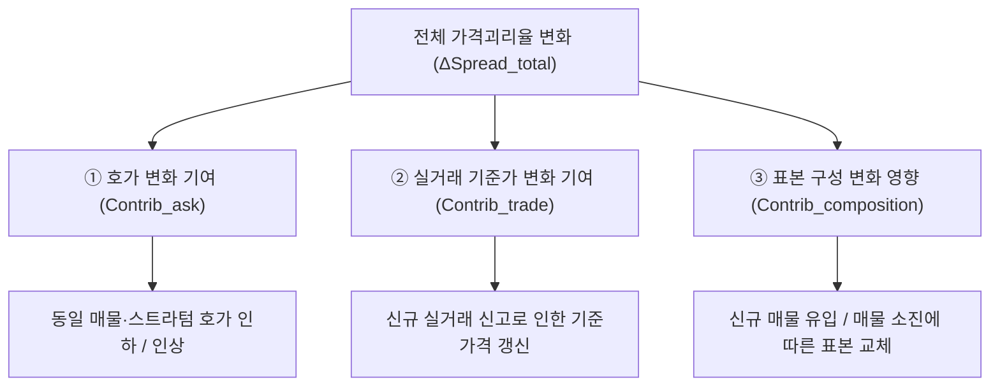

# APT WATCH — 가격괴리 변화폭(Spread Dynamics) 시계열 구축 및 3대 요인 분해 방법론

**문서 버전:** v1.0.0  
**작성 기준일:** 2026년 11월 13일  
**연구 주체:** APT WATCH 데이터저널리즘 랩  
**서비스 URL:** [https://raspos.github.io/apt-watch/](https://raspos.github.io/apt-watch/)  
**저장소:** [https://github.com/raspos/apt-watch](https://github.com/raspos/apt-watch)  

---

## 1. 문제의식: 정적 괴리율에서 동학적 시계열로의 전환

기존 가격괴리지수(Price Divergence Index)는 특정 관측일 시점에서 매도 호가와 최근 유사 실거래 기준가격 사이의 백분율 차이를 측정합니다. 그러나 시장 참여자 및 정책 연구자에게 중요한 것은 **"현재 괴리율이 몇 %인가"라는 정적인 수준보다, "호가와 실거래가의 간격이 지금 벌어지고 있는가, 아니면 좁혀지고 있는가?"라는 동학적 변화 방향($\Delta\text{Spread}$)**입니다.

$$
\text{"지금 매도자가 부르는 가격과 시장의 실제 체결가격 사이의 틈은 확대되고 있는가, 축소되고 있는가?"}
$$

APT WATCH는 375개 핵심 표본 단지와 서울 25개 자치구를 대상으로 가격괴리율의 **일별(DoD), 주간(WoW, 7일), 월간(MoM, 28일)** 변화폭을 매일 관측하는 시계열 동학 체계를 구축합니다.

---

## 2. 핵심 기능: 가격괴리 변화의 3대 요인 분해 (3-Way Decomposition)

가격괴리율의 변화($\Delta\text{Spread}$)는 시장의 실제 가격 협상뿐만 아니라 다양한 통계적 요인에 의해 발생합니다. 이를 분해하지 않으면 시장의 실질적 변화와 표본 착시를 구분할 수 없습니다.

### 2-1. 수학적 분해 산식

동일 비교 스트라텀 $s$ (단지·전용면적·층구간 일치)에 대해:
- $A_s(t)$: $t$일의 호가 중위값
- $R_s(t)$: $t$일 이용 가능한 최근 실거래 기준가격 중위값

괴리율 및 로그 괴리는 다음과 같이 정의됩니다:
$$\text{Spread}_s(t) = \left( \frac{A_s(t)}{R_s(t)} - 1 \right) \times 100 \quad (\%)$$
$$\text{LogSpread}_s(t) = \ln A_s(t) - \ln R_s(t)$$

두 관측 시점 $t-k$와 $t$ 사이에서 동일 비교 그룹의 로그 괴리 변화는 다음 항등식을 만족합니다:
$$\Delta \text{LogSpread}_s = \Delta \ln A_s(t) - \Delta \ln R_s(t)$$

이를 서울 전체 및 자치구 집계 지수의 백분율 포인트(%p) 단위로 전개하면 다음의 엄밀한 3대 요인 분해가 성립합니다:

$$\Delta \text{Spread}_{\text{total}} = \text{Contrib}_{\text{ask}} + \text{Contrib}_{\text{trade}} + \text{Contrib}_{\text{composition}}$$

1. **호가 변화 기여 ($\text{Contrib}_{\text{ask}}$):**  
   동일 표본($S_{\text{matched}} = S_t \cap S_{t-k}$)에서 매도자가 호가를 조정한 데 따른 기여도.
   $$\text{Contrib}_{\text{ask}} = \text{median}_{s \in S_{\text{matched}}} \left( \frac{A_s(t) - A_s(t-k)}{R_s(t-k)} \times 100 \right)$$
2. **실거래 기준가격 변화 기여 ($\text{Contrib}_{\text{trade}}$):**  
   국토교통부 신규 계약 신고로 기준가격이 갱신된 데 따른 기여도 (기준가격 상승은 괴리율을 좁히므로 음의 부호).
   $$\text{Contrib}_{\text{trade}} = -\text{median}_{s \in S_{\text{matched}}} \left( \frac{R_s(t) - R_s(t-k)}{R_s(t-k)} \times 100 \right)$$
3. **표본 구성 변화 영향 ($\text{Contrib}_{\text{composition}}$):**  
   신규 매물 유입, 기존 매물 회수, 스트라텀 비중 변화로 인한 잔여 잔차 효과.
   $$\text{Contrib}_{\text{composition}} = \Delta \text{Spread}_{\text{total}} - (\text{Contrib}_{\text{ask}} + \text{Contrib}_{\text{trade}})$$

---

## 3. 두 계열의 분리 구축: 전체 관측 vs 동일 표본

| 계열 구분 | 명칭 | 대상 표본 | 목적 및 특징 | 시장 판단 우선순위 |
| :---: | :--- | :--- | :--- | :---: |
| **A계열** | **전체 관측 가격괴리율** | 당일 관측된 모든 유효 비교 스트라텀 ($S_t$) | 당일 시장의 전체 호가-실거래 간격을 폭넓게 포착 (표본 구성 변화에 영향 받음) | 보조 참조 |
| **B계열** | **동일 표본 가격괴리 변화** | 두 시점에 모두 존재하는 동일 스트라텀 및 동일 매물 패널 ($S_{\text{matched}}$) | 표본 교체 왜곡을 배제하고 **순수 가격 변화(호가 조정 및 실거래 갱신)**만을 측정 | **최우선 기준** |

---

## 4. 실거래 기준가격의 시점 관리 (Point-in-Time Traceability)

과거 시점의 가격괴리지수를 계산하거나 시계열 선행성을 검증할 때 미래 실거래 정보가 사전에 누출(Look-ahead bias)되는 것을 엄격히 차단합니다:
- **계약일 ($t_{\text{contract}}$):** 실제 매매 계약 체결일
- **실거래 공개 확인일 ($t_{\text{disclosed}}$):** 국토부 시스템에 실등록되어 APT WATCH가 수집한 날
- **원칙:** $t$일 기준 지수 산출 시 $t_{\text{disclosed}} \le t$인 실거래 자료만을 기준가격에 산입합니다.

---

## 5. 데이터 축적 품질 게이트 및 공백 처리 원칙

- **신뢰성 절대 준수:** APT WATCH의 일일 고빈도 관측은 2026년 11월 10~12일에 시작되었습니다. 과거 데이터를 임의로 보간(Interpolation)하거나 날짜를 건너뛰어 연결하지 않습니다.
- **기간별 공표 규칙:**
  - 관측 기간 < 7일: 7일 변화폭(WoW)은 **'축적 중 (7일차 대기)'**으로 산출 유보.
  - 관측 기간 < 28일: 28일 변화폭(MoM)은 **'축적 중 (28일차 대기)'**으로 산출 유보.
  - 1일차 기준선 단계: 전일 대비 변화는 2회차 수집 완료 시점까지 **'산출 대기 (2회차 수집 대기)'**로 고지.
- **90일 vs 180일 기준 분리:** 90일 실거래 기준과 180일 장기 실측치는 별도 계열로 관리하며 상호 혼합하지 않습니다.

---

## 6. 향후 시장 선행성 검증을 위한 계량경제학 모형 설계

데이터가 누적됨에 따라 가격괴리 변화폭이 미래 실거래가격을 선행하는지 검증하기 위한 3단계 계량 모형을 사전에 수립합니다:

- **[Model A (기준 모형)]**: 기존 통계 기반  
  $$\Delta \ln(P_{k, t+h}) = \alpha + \sum \beta_j \Delta \ln(P_{k, t-j}) + \sum \gamma_j \Delta \text{REB}_{k, t-j} + \sum \theta_j \Delta \text{KB}_{k, t-j} + \mu_k + \epsilon_{kt}$$
- **[Model B (괴리 변화 확장 모형)]**:  
  $$\Delta \ln(P_{k, t+h}) = [\text{Model A}] + \sum \lambda_j \Delta \text{Spread}_{k, t-j} + \eta_{kt}$$
- **[Model C (요인 분해 확장 모형)]**:  
  $$\Delta \ln(P_{k, t+h}) = [\text{Model A}] + \sum \phi_j \text{Contrib}_{\text{ask}, k, t-j} + \sum \psi_j \text{Contrib}_{\text{trade}, k, t-j} + \sum \omega_j \text{Contrib}_{\text{comp}, k, t-j} + \nu_{kt}$$

Diebold-Mariano(1995) 외표본 검정을 통해 Model B와 Model C가 기존 통계 대비 통계적으로 유의미한 예측 오차(RMSE) 감소를 달성하는지 실증합니다.
